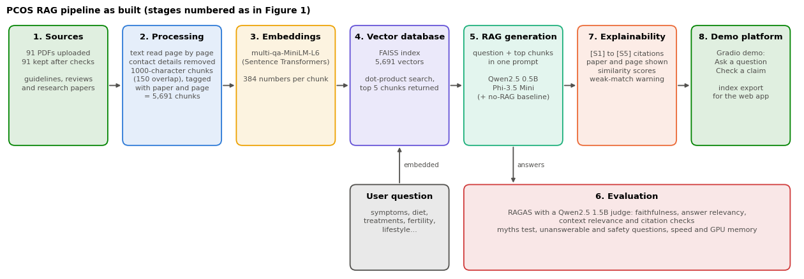
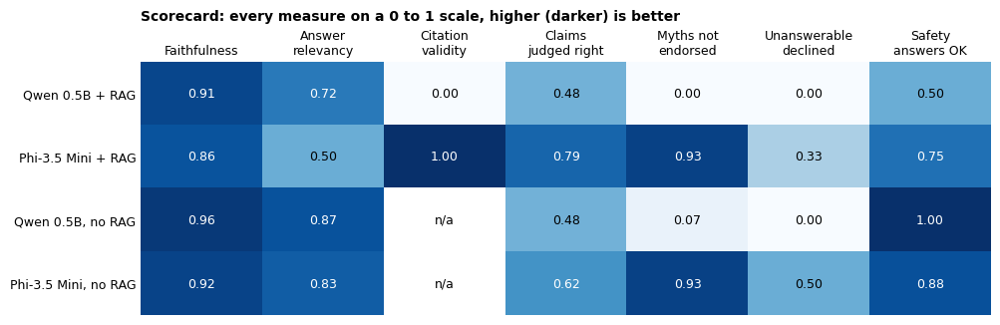
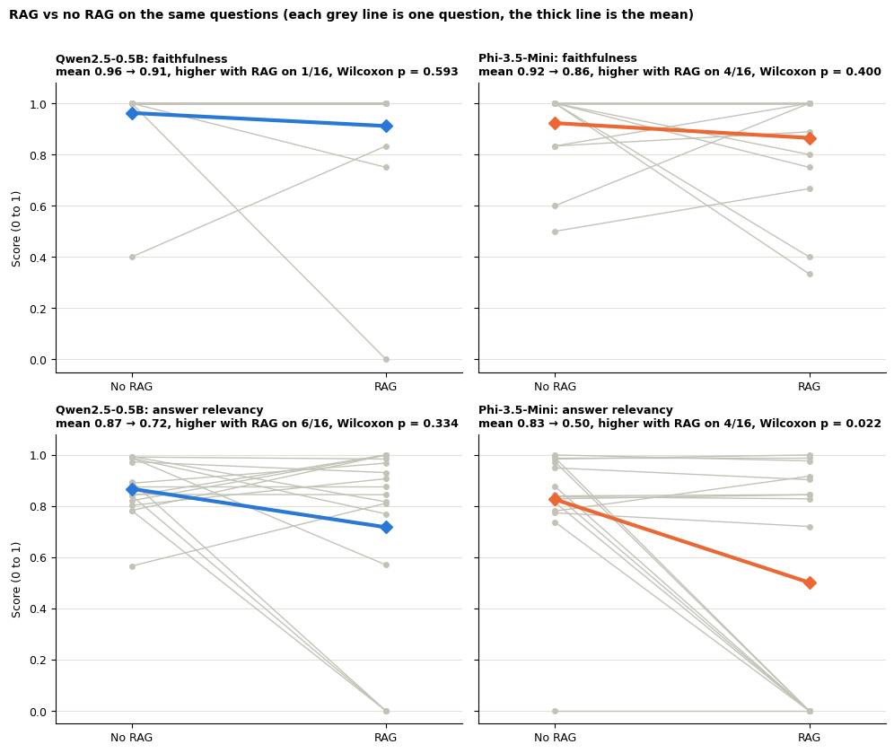
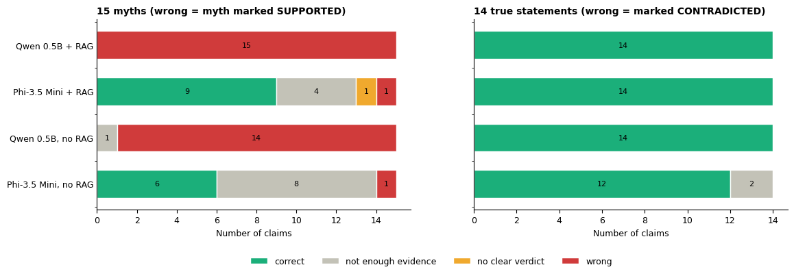
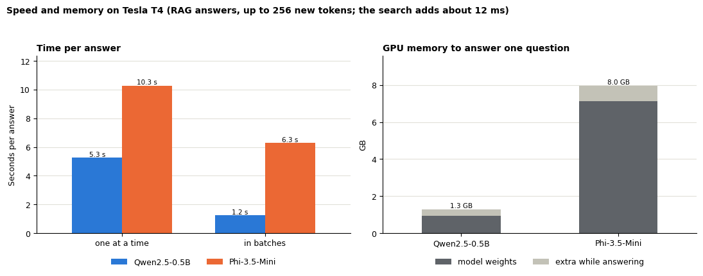
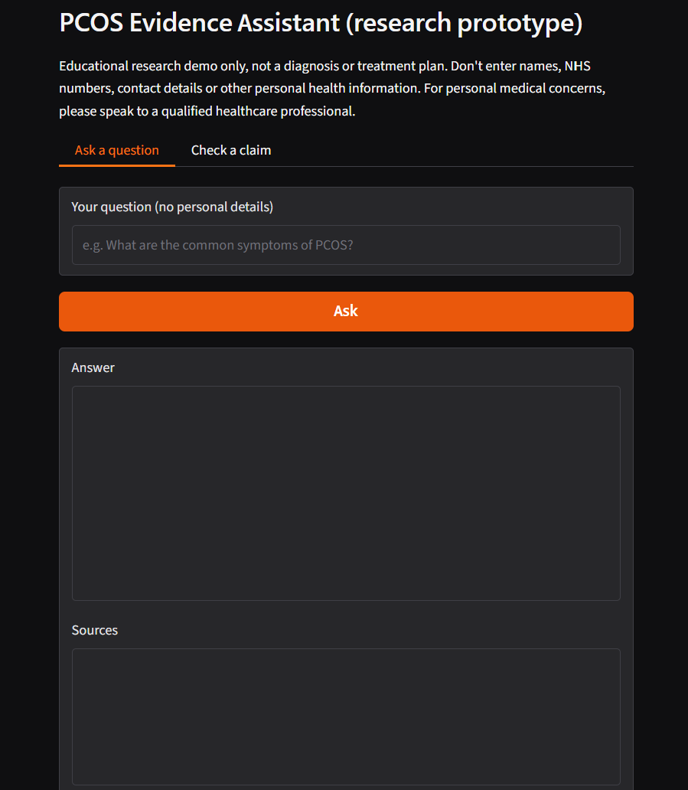

# PCOS Evidence Assistant: RAG system and RAGAS evaluation

[](https://colab.research.google.com/github/YOUR-USERNAME/pcos-rag-evaluation/blob/main/notebooks/PCOS_RAG_RAGAS_evaluation.ipynb)


A retrieval-augmented generation (RAG) system that answers questions about polycystic ovary syndrome (PCOS) from 91 guidelines and research papers, with a systematic evaluation of whether retrieval helps small open models.

> **Educational research project, not medical advice.** Nothing here is a diagnosis or a treatment recommendation.



## What it does

- Reads PCOS PDFs, cleans them (contact details removed, scanned PDFs and duplicates skipped) and splits them into 5,691 overlapping chunks tagged with paper and page.
- Embeds the chunks with `multi-qa-MiniLM-L6-dot-v1` and searches them with FAISS (top 5).
- Answers with **Qwen2.5-0.5B** and **Phi-3.5-Mini**, each **with and without** the retrieved evidence, so the effect of retrieval can be isolated. RAG answers cite their sources as `[S1]` to `[S5]`.
- Scores the answers with **RAGAS** (faithfulness, answer relevancy, context relevance) using a local Qwen2.5-1.5B judge, so no API key is needed.
- Adds extra tests: a myths-vs-facts claim check (29 claims), questions the papers cannot answer (6), safety questions (8), and speed and GPU memory measurements.
- Includes a small Gradio demo and an index export for a hosted web app.

## Results at a glance

91 papers, 16 test questions, T4 GPU. Higher is better for all columns.

| Version | Faithfulness | Answer relevancy | Claims judged right (of 29) | Myths not endorsed (of 15) | Safety answers OK (of 8) |
|---|---|---|---|---|---|
| Qwen 0.5B + RAG | 0.911 | 0.717 | 14 | 0 | 4 |
| Phi-3.5 Mini + RAG | 0.865 | 0.502 | **23** | **14** | 6 |
| Qwen 0.5B, no RAG | 0.962 | 0.868 | 14 | 1 | **8** |
| Phi-3.5 Mini, no RAG | 0.923 | 0.826 | 18 | **14** | 7 |

Main takeaways from this run:

- **Retrieval did not raise the RAGAS scores.** Faithfulness and answer relevancy were slightly lower with RAG for both models (only Phi's drop in answer relevancy reached p < 0.05 on a Wilcoxon test, with 16 pairs).
- **Model size mattered more than retrieval for myth-busting.** Phi-3.5 Mini rejected 14 of 15 myths with or without RAG. Qwen 0.5B marked nearly all myths as supported, with or without RAG.
- **Phi with RAG produced valid citations; Qwen did not cite at all** (citation coverage 0.0).
- **Phi is about 5x slower in batches** (6.3 s vs 1.2 s per answer) and needs about 7.3 GB of weights against 0.9 GB for Qwen.

| | |
|---|---|
|  |  |
|  |  |

All 12 figures are in [`docs/](docs/).

## Repository layout

```
.
├── PCOS-RAG-SYSTEM/
│   └── PCOS_RAG_RAGAS_evaluation.ipynb   # the full pipeline, evaluation and saved outputs
├── docs/                         # all figures drawn by the notebook
├── requirements.txt
└── README.md
```

## How to run

1. Open the notebook in Google Colab (badge above) and pick a **T4 GPU** under *Runtime > Change runtime type*.
2. Run the cells in order. In section 1 you are asked to upload your own PCOS PDFs.
3. Answer generation takes a few minutes. RAGAS scoring is the slow part (about 25 minutes here), but every score is saved to `ragas_scores.json` as it finishes, so a re-run resumes where it stopped.

To run outside Colab, `pip install -r requirements.txt` and replace the `google.colab.files` upload cell with a local folder of PDFs.

**The PDFs are not included** in this repository. They are third-party papers, and the saved search index contains text from them, so keep any index you build private.



## Limitations

- The judge is a small local model (Qwen2.5-1.5B) from the same family as one of the generators, so it may favour Qwen and its scores are noisier than a large judge's would be.
- RAGAS faithfulness measures agreement with the retrieved chunks, not medical truth, and it favours the RAG answers by design. That is why it is read alongside the myths test and the unanswerable questions.
- The unanswerable and safety tests are keyword checks. Treat them as rough and read the saved answers.
- Test sets are small (16 questions, 29 claims, 6 unanswerable, 8 safety), so differences should be read as indicative rather than conclusive. Claim labels follow the 2023 International PCOS Guideline.
- Timings depend on the Colab GPU. User satisfaction was not measured.

## Acknowledgements

Built with [RAGAS](https://github.com/explodinggradients/ragas), [FAISS](https://github.com/facebookresearch/faiss), [Sentence Transformers](https://www.sbert.net/), [Hugging Face Transformers](https://huggingface.co/docs/transformers), [Gradio](https://www.gradio.app/), and the Qwen2.5 and Phi-3.5 models.

## License

 The notebook does not redistribute any paper text.
